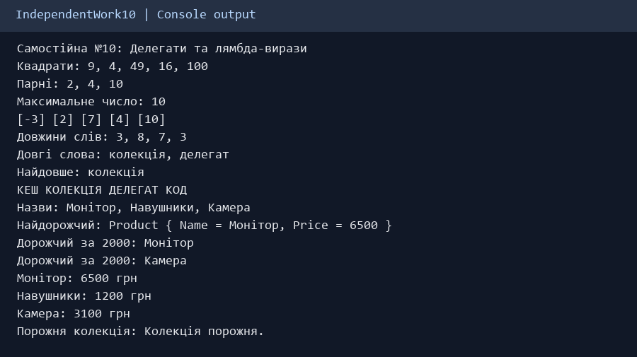

# Самостійна робота №10

## Реалізація

CollectionUtils реалізує чотири generic-методи власними циклами: Map, MaxBy, Filter, ForEach. Демонстрація використовує три колекції List<int>, List<string>, List<Product>; кожен метод отримує різні лямбда-вирази для цих типів. MaxBy на однакових ключах зберігає перший елемент, а для порожнього джерела викидає InvalidOperationException. Для null-аргументів передбачено ArgumentNullException; ключі порівнюються через Comparer<TKey>.Default, у тому числі при null-ключі посилального типу.

## Відповіді до завдання 4

Делегати дозволяють передати поведінку окремо від циклу: утиліта знає, як перебрати колекцію, але не прив'язана до конкретного способу перетворення чи відбору. Наприклад, один Map може піднести числа до квадрата або отримати назви товарів.

Лямбда `p => p.Price` описує вибір ключа без окремого іменованого методу чи класу. Типи параметрів виводяться компілятором, а логіка лишається поряд із викликом утиліти.

Map відповідає Select, Filter — Where, MaxBy — Enumerable.MaxBy. Власні Map/Filter одразу створюють List: час O(n), додаткова пам'ять O(n); LINQ Select/Where зазвичай використовують відкладене виконання та не потребують матеріалізації всієї колекції. MaxBy виконує один прохід, O(n) часу та O(1) додаткової пам'яті. ForEach відразу виконує Action для кожного елемента; загального Enumerable.ForEach у LINQ немає, є List<T>.ForEach та звичайний foreach. Для порожнього джерела поведінка нашого MaxBy явно визначена як виняток і може відрізнятися від Enumerable.MaxBy для посилальних типів.

## Контрольні запитання

1. Делегат задає контракт виклику поведінки, а generic-параметри дозволяють застосувати її до різних типів даних.
2. Func<T,TResult> повертає TResult, Predicate<T> повертає bool, Action<T> нічого не повертає.
3. Поєднання generics і лямбд дає короткі типобезпечні виклики без дублювання циклів.
4. Власні методи корисні для навчання, спеціальних перевірок і специфічних контрактів; для звичайного виробничого коду переважно варто використати готовий LINQ.

## Висновок

Алгоритм перебору та предметна поведінка відокремлені. Порівняння з LINQ показує, що важливі не тільки результати, а й момент виконання, використання пам'яті та контракт для порожніх колекцій.

---

## Запуск

З папки `IndependentWork10`:

```powershell
dotnet run --configuration Release
```

Умова та журнали: [матеріали роботи](../Materials/IndependentWork10/).

---

## Вивід програми


