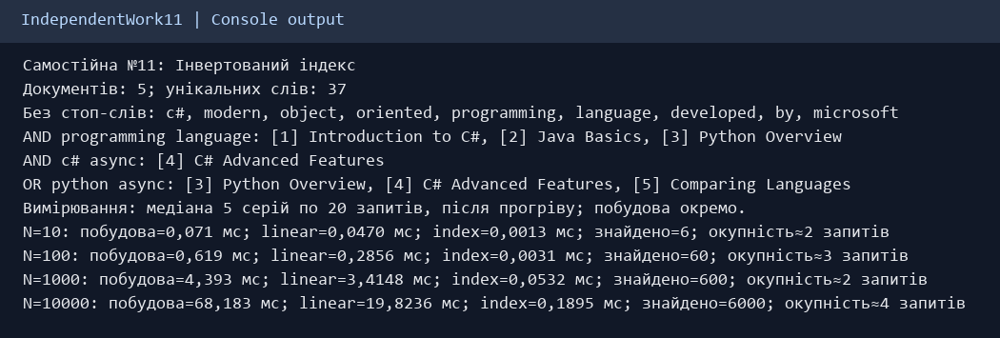

# Самостійна робота №11

## Реалізація

InvertedIndex зберігає слово → HashSet<int> та ID → Document. AddDocument розбиває Content на слова, додає ID до множини кожного слова; повторний ID замінює старий документ і прибирає старі входження. Документи незмінні (record), результати пошуку — окремі списки. SearchSingleWord знаходить одне слово, SearchMultipleWords застосовує IntersectWith (AND), SearchAnyWord — UnionWith (OR). Результат відсортований за ID; порожній запит повертає порожній список.

Regex зберігає Unicode-літери та числа, а також суфікси # і ++: C# не зливається з C. Дефіс і / розділяють слова. Нормалізація однакова для індексу, запиту та лінійного пошуку. RemoveStopWords реалізовано й продемонстровано окремо, але в порівнянні пошуку стоп-слова не видаляються, щоб обидва підходи мали однакову семантику.

У програмі використано п'ять документів із методички та автоматично згенеровані повторення цих текстів для потрібних розмірів. Інтерактивний інтерфейс виконує AND-пошук до exit або завершення вводу. Параметр --demo пропускає лише інтерактивний цикл для автоматичної перевірки.

## Фактичні вимірювання

Release, .NET 10, після прогріву: медіана 5 серій по 20 запитів C#. В обох підходах матеріалізуються результати; перевіряється рівність усіх знайдених ID, а не лише їх кількість. Побудова індексу вимірюється окремо. Вивід до консолі не входить у вимірювання пошуку.

| Документів | Побудова, мс | Лінійний, мс/запит | Індекс, мс/запит | Знайдено | Окупність, запитів |
| --- | --- | --- | --- | --- | --- |
| 10 | 0.071500 | 0.047050 | 0.001305 | 6 | 2 |
| 100 | 0.618500 | 0.285580 | 0.003110 | 60 | 3 |
| 1000 | 4.393400 | 3.414790 | 0.053215 | 600 | 2 |
| 10000 | 68.183400 | 19.823615 | 0.189520 | 6000 | 4 |

На цьому наборі індекс окупав побудову приблизно за 2–4 запити: ceil(BuildMs / (LinearMs − IndexMs)). Це оцінка для повторення того самого запиту, без обліку оновлень і вартості пам'яті, а не універсальний поріг. Для одного запиту до нового набору лінійний пошук може бути вигіднішим. Вартість повернення k результатів щонайменше O(k); наша реалізація також сортує ID, тому весь пошук не можна назвати O(1), навіть якщо доступ до словника в середньому O(1).

## Контрольні запитання та висновки

1. Dictionary швидко знаходить список входжень слова, HashSet не дублює ID документа при кількох появах слова.
2. IntersectWith/UnionWith безпосередньо виражають логіку AND/OR, без ручного пошуку дублікатів у List.
3. Різні правила токенізації змінюють результати та роблять порівняння часу некоректним, наприклад C# проти C або підрядок проти цілого слова.
4. Простий індекс не враховує словоформи, релевантність і точні фрази. Він потребує пам'яті та оновлення після змін документів. Для багатьох запитів до стабільного набору витрати на побудову компенсуються швидшим пошуком.

---

## Запуск

З папки `IndependentWork11`:

```powershell
dotnet run --configuration Release
```

Для запуску без інтерактивного пошуку: `dotnet run --configuration Release -- --demo`.

Умова та журнали: [матеріали роботи](../Materials/IndependentWork11/).

---

## Вивід програми


