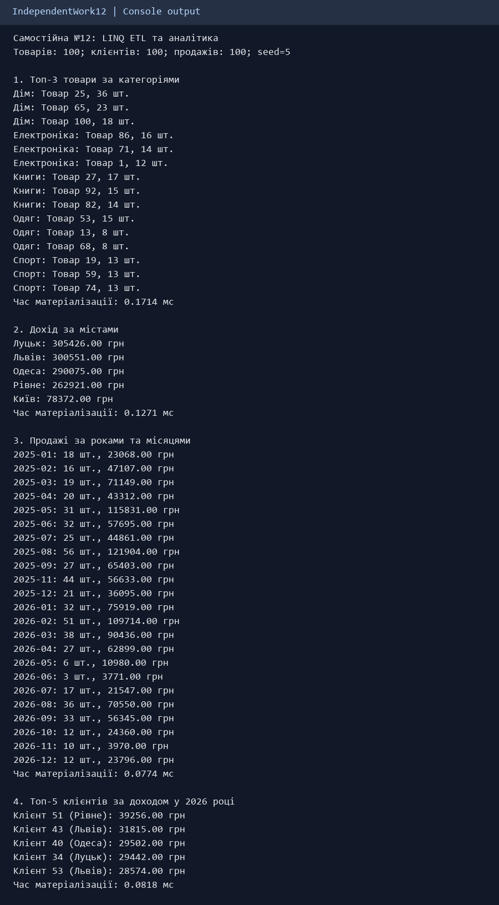

# Самостійна робота №12

## Дані та пайплайни

Створено по 100 Product, Customer і Sale. Дані генеруються з Random(5), ідентифікатори продажів посилаються на наявні продукти/клієнтів, ціни та кількості додатні. Використано п'ять категорій, п'ять міст і дати за 2025–2026 роки. ETL: Extract — початкові списки; Transform — Join, GroupBy, обчислення; Load — матеріалізований результат і консольний вивід.

1. TopProductsByCategory: GroupBy за ProductId, Sum кількості, Join із продуктами, GroupBy категорії, OrderByDescending та Take(3). SelectMany повертає плаский список трьох лідерів кожної категорії. ThenBy за ID стабілізує порядок при рівних значеннях.
2. RevenueByCity: два Join додають ціну та місто покупця, GroupBy збирає міста, Sum підсумовує Quantity × UnitPrice; OrderByDescending показує міста від найбільшого доходу.
3. MonthlySales: Join із продуктами, GroupBy за парою Year/Month, Sum кількості й доходу, OrderBy/ThenBy формують хронологічний порядок. Відсутні місяці не виводяться як нульові.
4. TopCustomers2026: власний запит із Where за роком, Join із цінами, GroupBy покупця, Sum витрат, Join із клієнтами, сортування та Take(5). Показує клієнтів із найбільшим доходом у 2026 році.

## Фактичні вимірювання

Для кожного запиту створено окремий Stopwatch після одного прогріву. Вимірюється виконання з ToList і формуванням рядків; консольний вивід не включено. Release, .NET 10. Це короткий навчальний замір, а не строгий статистичний бенчмарк.

| Пайплайн | Час, мс |
| --- | --- |
| 1 | 0.171400 |
| 2 | 0.127100 |
| 3 | 0.077400 |
| 4 | 0.081800 |

Найбільший виміряний час мав пайплайн №1. Перший запит містить два рівні групування і сортування всередині категорій; другий — два Join. Різницю на 100 продажах також можуть визначати JIT, кеш процесора, алокації та фонові процеси, тому ці цифри не доводять загальну перевагу одного запиту. Ранній Where у четвертому зменшує обсяг даних до Join. Повторна матеріалізація та зайві проходи на більших наборах збільшують вартість.

## Контрольні запитання

1. LINQ дає декларативні кроки обробки, які простіше компонувати та читати, ніж кілька вкладених циклів; ручні цикли іноді дають точніший контроль алокацій.
2. Join збагачує дані, GroupBy формує групи, Select обчислює результат, OrderBy визначає потрібний порядок звіту.
3. Впливають кількість елементів, розподіл ключів, матеріалізація, кількість сортувань, алокації та повторне виконання відкладених запитів.
4. Кожен запит винесено в окремий метод із предметною назвою. Для перевірки варто зіставити результати з невеликим ручним прикладом і перевірити, що сума доходів за містами та місяцями збігається із загальною.

## Висновок

LINQ зручний для послідовного опису ETL й аналітики в пам'яті. На великих обсягах потрібно контролювати ранню фільтрацію, вартість групувань і сортувань, а також фактичну матеріалізацію під час вимірювання.

---

## Запуск

З папки `IndependentWork12`:

```powershell
dotnet run --configuration Release
```

Умова та журнали: [матеріали роботи](../Materials/IndependentWork12/).

---

## Вивід програми


