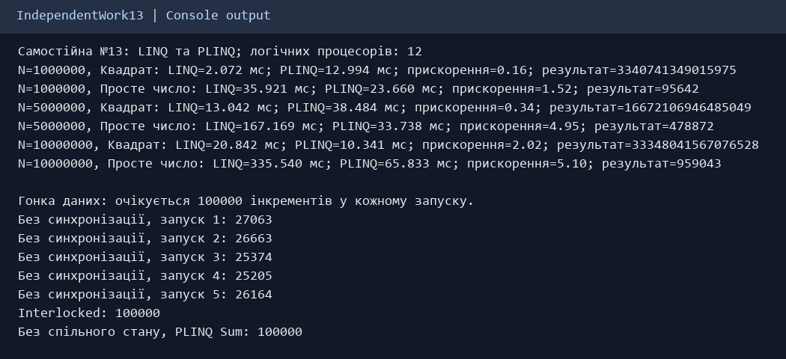

# Самостійна робота №13

## Експеримент

Використано List<int> на 1, 5 та 10 мільйонів елементів, Random(5), числа від 2 до 99999. Для кожного обсягу порівняно дві операції: дешевий квадрат числа та дорожчу перевірку простоти перебором дільників. Обидва підходи мають Where → Select → Sum; PLINQ додає AsParallel. Довгий тип long запобігає переповненню суми квадратів. Суми LINQ та PLINQ перевіряються на рівність.

Release, .NET 10, 12 логічних процесорів під час запуску. Наведено медіану трьох запусків після прогріву; порядок LINQ/PLINQ чергується. Генерація даних і консольний вивід не входять у час. Це навчальний замір із малою кількістю повторів: планувальник, частота CPU, кеш, GC та стороннє навантаження можуть суттєво змінювати короткі вимірювання.

| Елементів | Операція | LINQ, мс | PLINQ, мс | Прискорення |
| --- | --- | --- | --- | --- |
| 1000000 | Квадрат | 2.072100 | 12.994000 | 0.1595 |
| 1000000 | Просте число | 35.921200 | 23.660400 | 1.5182 |
| 5000000 | Квадрат | 13.041900 | 38.483600 | 0.3389 |
| 5000000 | Просте число | 167.169200 | 33.738300 | 4.9549 |
| 10000000 | Квадрат | 20.841800 | 10.341200 | 2.0154 |
| 10000000 | Просте число | 335.539600 | 65.833300 | 5.0968 |

PLINQ був швидшим у 4 із 6 виміряних комбінацій. Для перевірки простоти паралельна версія виграла на всіх трьох обсягах: витрати на розподіл роботи компенсує більша вартість кожного елемента. Для квадрата на 1M та 5M PLINQ програв, а на 10M виграв; це не гарантує монотонного прискорення на інших комп'ютерах або повторних запусках. При дешевих операціях накладні витрати можуть переважати корисну роботу. Прискорення визначене як LINQms / PLINQms; значення менше 1 означає програш PLINQ.

## Побічний ефект та виправлення

У п'яти прогонах 100000 паралельних інкрементів спільна змінна без синхронізації дала значення: 27063, 26663, 25374, 25205, 26164. Читання, збільшення та запис не є єдиною атомарною операцією: кілька потоків можуть прочитати старе значення й затерти результати один одного. Thread.SpinWait навмисно розширює це вікно для демонстрації; ця гонка не використовується у вимірюванні продуктивності. Її результат недетермінований і не повинен бути очікуваним значенням юніт-тесту.

Interlocked.Increment атомарно змінює лічильник і дав рівно 100000. Ще краще уникати спільного змінного стану: Select(_ => 1).Sum() дає 100000 без власної синхронізації. Lock теж забезпечив би коректність, але серіалізував би критичну секцію.

## Контрольні запитання та висновки

1. PLINQ корисний на достатньо великих джерелах з дорогими незалежними операціями й доступними ядрами CPU.
2. Спільні змінні всередині лямбд створюють гонки даних; порядок виконання потоків не визначений.
3. Кілька обсягів показують, коли накладні витрати паралелізації окупаються; один випадок не описує масштабування.
4. Якщо PLINQ повільніший, варто залишити LINQ або зменшити синхронізацію/переглянути гранулярність роботи. Паралельність не є автоматичною оптимізацією, а правильність важливіша за прискорення.

---

## Запуск

З папки `IndependentWork13`:

```powershell
dotnet run --configuration Release
```

Умова та журнали: [матеріали роботи](../Materials/IndependentWork13/).

---

## Вивід програми


