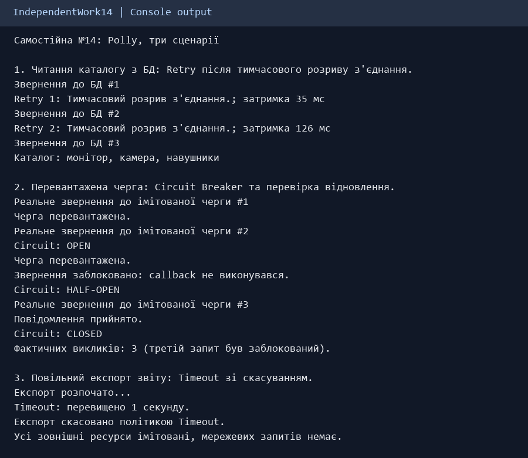

# Самостійна робота №14

Використано реальний пакет Polly.Core 8.9.1 і API ResiliencePipelineBuilder. Код імітує ресурси та не підключається до справжніх БД чи черг. Повний фактичний журнал наведено нижче та в матеріалах роботи.

## 1. Читання каталогу з БД: Retry

Проблема: тимчасовий розрив з'єднання під час читання. Обрано максимум три повтори з експоненційною затримкою та jitter; обробляється тільки IOException. Читання не змінює дані й допускає повтор. У нашій імітації IOException позначає розрив; для справжнього драйвера слід вибрати його типи тимчасових помилок, а не повторювати всі винятки.

```csharp
new ResiliencePipelineBuilder().AddRetry(new RetryStrategyOptions
{
    ShouldHandle = new PredicateBuilder().Handle<IOException>(),
    MaxRetryAttempts = 3,
    Delay = TimeSpan.FromMilliseconds(100),
    BackoffType = DelayBackoffType.Exponential,
    UseJitter = true
}).Build();
```

Перші два виклики падають, OnRetry друкує номер, причину та фактичну затримку; третій повертає каталог. Кількість спроб обмежена, а випадкові затримки відрізняються при повторному запуску. API та конфігурацію звірено з [документацією Retry](https://www.pollydocs.org/strategies/retry.html).

## 2. Перевантажена черга: Circuit Breaker

Проблема: повторні запити до недоступної черги лише збільшують навантаження. AddCircuitBreaker налаштовано на FailureRatio = 1, MinimumThroughput = 2, SamplingDuration = 5 с, BreakDuration = 600 мс. Дві невдачі відкривають circuit; наступний запит отримує BrokenCircuitException без виконання callback. Після 750 мс та відновлення імітованої черги пробний запит переводить HALF-OPEN → CLOSED. Логи OnOpened, OnHalfOpened, OnClosed показують переходи.

```csharp
new ResiliencePipelineBuilder().AddCircuitBreaker(new CircuitBreakerStrategyOptions
{
    ShouldHandle = new PredicateBuilder().Handle<HttpRequestException>(),
    FailureRatio = 1,
    MinimumThroughput = 2,
    SamplingDuration = TimeSpan.FromSeconds(5),
    BreakDuration = TimeSpan.FromMilliseconds(600)
}).Build();
```

Circuit Breaker спостерігає за невдачами, але не повторює операції самостійно. Навчальні короткі інтервали не є готовими налаштуваннями виробничої черги. Поведінку звірено з [документацією Circuit Breaker](https://www.pollydocs.org/strategies/circuit-breaker.html).

## 3. Повільний експорт звіту: Timeout

Проблема: користувач не повинен необмежено чекати експорт. AddTimeout обмежує виконання однією секундою. Імітація експорту очікує три секунди через Task.Delay, отримуючи cancellationToken від Polly; OnTimeout логуватиме перевищення, а catch обробляє TimeoutRejectedException.

```csharp
var pipeline = new ResiliencePipelineBuilder()
    .AddTimeout(TimeSpan.FromSeconds(1)).Build();
await pipeline.ExecuteAsync(async cancellationToken =>
    await Task.Delay(TimeSpan.FromSeconds(3), cancellationToken));
```

Операція має враховувати токен: Timeout не примусово зупиняє довільний синхронний код. Це кооперативне скасування, відповідно до [документації Timeout](https://www.pollydocs.org/strategies/timeout.html).

## Контрольні запитання та висновки

1. Retry допомагає при тимчасових збоях, Circuit Breaker захищає недоступний ресурс від потоку нових звернень, Timeout обмежує очікування.
2. Стратегії можна комбінувати: наприклад, зовнішній Timeout обмежує весь бюджет Retry, внутрішній — одну спробу. Порядок стратегій впливає на загальну поведінку та кількість звернень. У роботі стратегії показані окремо, щоб побачити кожну.
3. Логи дозволяють відрізнити реальний виклик від заблокованого та побачити затримку, кількість повторів і остаточний результат.
4. Повтор створення замовлення чи платежу може продублювати дію, якщо відповідь втрачена після успішного виконання. Потрібні ідемпотентний ключ або інша гарантія безпечного повтору.

Polly прибирає дублювання механізмів відмовостійкості й дає налаштовувані стратегії з подіями. Вона не виправляє невірні дані, не забезпечує ідемпотентність бізнес-операцій та потребує осмисленого ліміту часу і повторів.

---

## Запуск

З папки `IndependentWork14`:

```powershell
dotnet run --configuration Release
```

Умова та журнали: [матеріали роботи](../Materials/IndependentWork14/).

---

## Вивід програми


