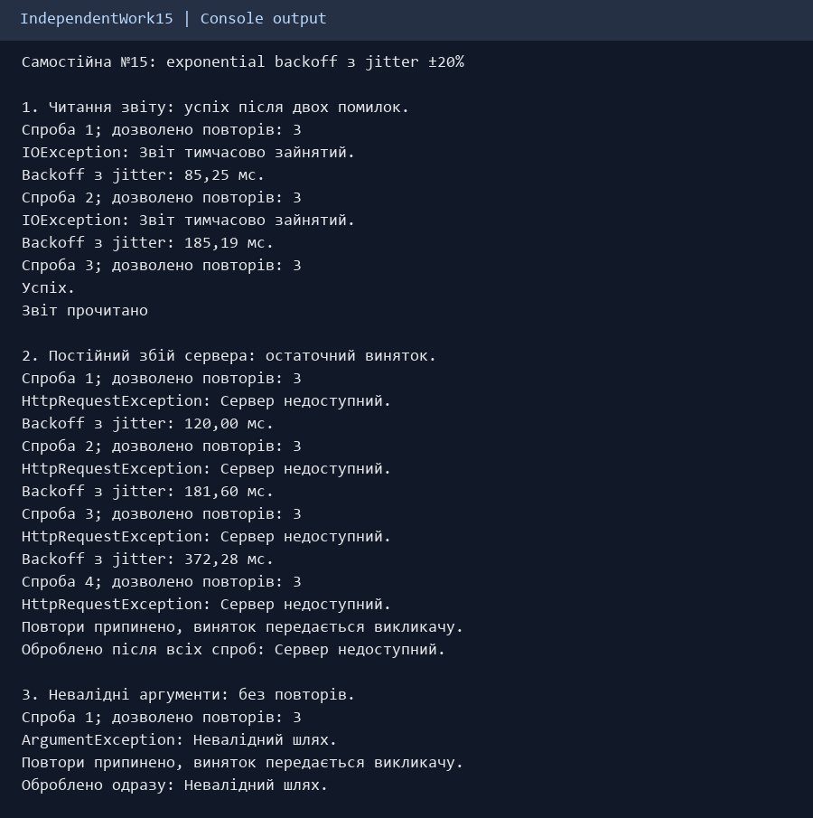

# Самостійна робота №15

## Реалізація та демонстрація

RetryPolicy має поля _maxRetries, _initialDelay, _jitterFactor та узагальнений Execute<T>(Func<T>, Func<Exception,bool>?). Параметри перевіряються: maxRetries ≥ 0, затримка невід'ємна й у допустимому діапазоні, jitterFactor — скінченне число від 0 до 1. MaxRetries означає повтори після першої спроби: 3 повтори — максимум 4 виконання.

Формула перед повтором із retryAttempt, що починається з 0:

```csharp
delay = initialDelay.TotalMilliseconds * Math.Pow(2, retryAttempt)
      * (1 + Random.Shared.NextDouble() * jitterFactor * 2 - jitterFactor);
```

Для initialDelay = 100 мс і jitterFactor = 0.2 інтервали становлять [80,120), [160,240), [320,480) мс. Перед Thread.Sleep застосовується верхня межа int.MaxValue мс, щоб не вийти за підтримуваний діапазон. Нульова початкова затримка залишається нульовою. Random.Shared придатний для отримання випадкових значень з кількох потоків, але сама операція відповідає за власний стан.

Логуються кожен виклик, тип і повідомлення винятку та затримка. При вичерпанні спроб або false від shouldRetry використовується throw; зі збереженням стеку. Без власного предиката повторюються лише IOException та HttpRequestException; OperationCanceledException та помилки аргументів автоматично не повторюються.

Main демонструє читання звіту з успіхом після двох помилок, постійний мережевий збій з остаточним винятком та ArgumentException без повтору. Фактичні затримки наведено в ../Materials/IndependentWork15/console-output.txt; через jitter вони змінюються при кожному запуску.

## Контрольні запитання та висновок

1. Експоненційна затримка збільшує час на відновлення ресурсу та зменшує частоту наступних звернень порівняно з коротким фіксованим інтервалом.
2. Jitter розподіляє повтори різних клієнтів у часі й зменшує ймовірність одночасного нового піку навантаження.
3. shouldRetry відбирає тимчасові збої за типом або ознаками винятку. Виправити неправильний шлях повторенням неможливо.
4. Забороняють повтори помилок валідації, скасованих операцій та дій, які можуть дублювати незворотні зміни. Повтор допустимий лише за зрозумілого контракту ідемпотентності або механізму дедуплікації.

Реалізація підходить для навчальної синхронної програми: Thread.Sleep блокує потік. Для асинхронного сервера потрібні Task.Delay, cancellationToken, загальний часовий бюджет і обмеження максимального backoff. Retry компенсує тимчасові збої, але не усуває причину постійної несправності.

---

## Запуск

З папки `IndependentWork15`:

```powershell
dotnet run --configuration Release
```

Умова та журнали: [матеріали роботи](../Materials/IndependentWork15/).

---

## Вивід програми


