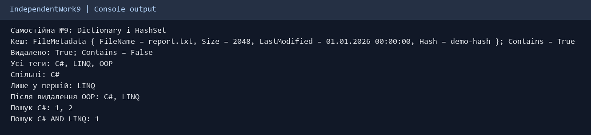

# Самостійна робота №9

## Три приклади з відкритих проєктів

### 1. Dictionary: Newtonsoft.Json 13.0.3

У [BidirectionalDictionary](https://github.com/JamesNK/Newtonsoft.Json/blob/13.0.3/Src/Newtonsoft.Json/Utilities/BidirectionalDictionary.cs) два словники зберігають відповідність в обох напрямках: TFirst → TSecond та TSecond → TFirst. Конструктор приймає окремі IEqualityComparer для обох типів, а TryGetByFirst/TryGetBySecond використовують TryGetValue. Це дає середній пошук O(1) замість сканування List за O(n), ціною двох індексів і додаткової пам'яті. Додавання має перевіряти узгодженість обох напрямків. У найгіршому випадку через колізії доступ може бути O(n).

### 2. HashSet: .NET Runtime 10.0.0, LINQ Distinct

У [DistinctIterator](https://github.com/dotnet/runtime/blob/v10.0.0/src/libraries/System.Linq/src/System/Linq/Distinct.cs) HashSet зберігає вже побачені значення. Якщо Add повертає true, ітератор віддає елемент; повтори пропускаються. Переданий comparer визначає рівність елементів. Середня складність повного Distinct — O(n), пам'ять — O(u), де u — кількість унікальних значень. Пошук попередніх значень у List міг би дати O(n²). Порядок видачі забезпечує перебір джерела, а не внутрішній порядок HashSet.

### 3. Dictionary + HashSet: EF Core 10.0.0

У [Model](https://github.com/dotnet/efcore/blob/v10.0.0/src/EFCore/Metadata/Internal/Model.cs) поле _propertiesByType має тип Dictionary<Type, HashSet<Property>>. Методи AddProperty, FindProperties та RemoveProperty підтримують індекс властивостей за CLR-типом. Dictionary швидко знаходить групу, а HashSet запобігає дублюванню властивостей у ній. У цих операціях використані стандартні правила рівності Type та Property; явний custom comparer для цього поля не передається. Середній пошук групи та додавання/видалення властивості — O(1), перебір групи — O(k). List вимагав би сканування груп та окремої перевірки дублікатів. Це внутрішній API бібліотеки, наведений для аналізу, а не залежність нашого застосунку.

## Практична реалізація

FileMetadataCache реалізує Add/Get/Remove/Contains; імена файлів порівнюються через OrdinalIgnoreCase, що відповідає обраному сценарію Windows, але не всім файловим системам. FileMetadata містить ім'я, розмір, дату зміни й демонстраційне значення хешу: програма не обчислює справжній хеш файлу.

TagManager зберігає множину тегів для кожної статті. UnionWith об'єднує теги, IntersectWith знаходить спільні, ExceptWith — теги лише першої статті. Копії результатів не дозволяють випадково змінити внутрішні дані. Різний регістр тегів не створює дублікатів.

SearchIndex використовує слово як ключ і множину ID як значення. Токенізація нормалізує регістр і пунктуацію, зберігаючи C#. SearchMultiple перетинає множини; повторне додавання документа замінює його старі входження. Порожній запит повертає порожню множину. Приклади викликів і фактичний вивід наведено нижче.

## Порівняння складності

Тут середні/амортизовані оцінки для хеш-структур; колізії та розширення можуть дати O(n).

| Операція | List<T> | Dictionary<TKey,TValue> | HashSet<T> | Застосування |
|---|---|---|---|---|
| Додавання | O(1) амортизовано | O(1) амортизовано | O(1) амортизовано | Список / відповідність / множина |
| Пошук за значенням | O(n) | O(n), ContainsValue | O(1) у середньому | HashSet для перевірки елемента |
| Пошук за ключем | Немає ключа; індекс O(1) | O(1) у середньому | Немає пари ключ–значення | Dictionary |
| Видалення за значенням/ключем | O(n) | O(1) у середньому | O(1) у середньому | Словник / множина |
| Перевірка наявності | O(n) | O(1) за ключем | O(1) у середньому | Часті перевірки |

## Висновки та контрольні запитання

1. Generic-колекції забезпечують типобезпечність і повторне використання алгоритмів, для значимих типів уникають типового boxing неузагальнених колекцій.
2. Dictionary потрібен для відповідностей і кешів, HashSet — для унікальності та множинних операцій; List зручний для впорядкованої послідовності та доступу за індексом.
3. Comparer повинен узгоджувати Equals та GetHashCode. Зміна полів ключа, що впливають на хеш після вставлення, може зробити елемент недоступним; поганий хеш збільшує колізії. Ці колекції самі по собі не забезпечують синхронізацію одночасних змін.
4. Інвертований індекс поєднує швидкий пошук слова зі зручним AND/OR над множинами документів. Витрати пам'яті та побудови виправдані при повторних запитах.

---

## Запуск

З папки `IndependentWork9`:

```powershell
dotnet run --configuration Release
```

Умова та журнали: [матеріали роботи](../Materials/IndependentWork9/).

---

## Вивід програми


