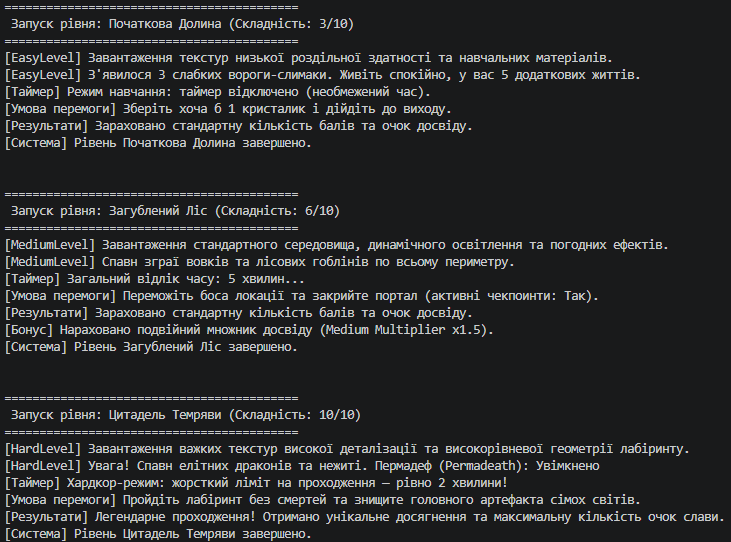

## 📦 Лабораторна робота №9
**Тема:** Поліморфні сервіси: Доставка товарів (`DeliveryService`)  
**Мета:** Застосувати поліморфізм для створення системи доставки з різними каналами, навчитися обробляти помилки в поліморфних класах та використовувати списки базового типу.

### Короткий опис реалізації
* **Базовий клас (`DeliveryService`):** Абстрактний клас, що містить спільні властивості (`Address`, `IsItemAvailable`) та абстрактні методи `Validate()` і `Deliver()`.
* **Похідні класи (Варіант №5):**
  1. `CourierDelivery` — кур'єрська доставка з перевіркою імені кур'єра.
  2. `PostDelivery` — поштова доставка з валідацією поштового індексу (рівно 5 цифр).
  3. `PickupDelivery` — самовивіз із перевіркою назви філії магазину.
* **Клас-менеджер (`OrderDeliveryManager`):** Здійснює обробку списку доставки (`List<DeliveryService>`) у циклі з безпечним перехопленням винятків (`try-catch`), що дозволяє програмі продовжити роботу навіть при виникненні помилок валідації.

### Консольний вивід (Lab 9)
```text
--- Початок обробки доставки ---
[Кур'єрська доставка] Доставляємо за адресою: вул. Соборна, 15. Кур'єр: Олександр. Статус: Успішно доставлено!

--- Початок обробки доставки ---
[Поштова доставка] Відправлення на поштове відділення індексу 33000, адреса: вул. Київська, 42. Статус: Відправлено!

--- Початок обробки доставки ---
[Самовивіз] Замовлення готове до видачі у філії 'ТРЦ 'Злата Плаза'' за адресою: вул. Чорновола, 2. Статус: Очікує клієнта!

--- Початок обробки доставки ---
[Операційний виняток]: Помилка поштової доставки: Товар відсутній на складі.
```
