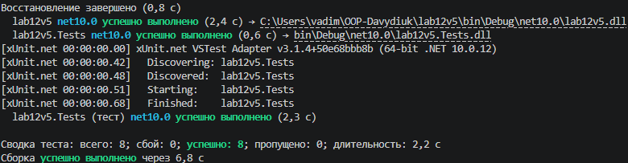

# Лабораторна робота №12: Узагальнені типи (Generics) та IRepository
**Варіант:** 5 (Сутність: `Customer`)

---

##  Структура проєкту
Репозиторій складається з двох проєктів:
1. **`lab12v5`** — основний консольний проєкт, що містить бізнес-логіку та реалізацію сховища даних у пам'яті.
2. **`lab12v5.Tests`** — проєкт для модульного тестування (xUnit), що перевіряє всі CRUD-операції.

```text
OOP-ВашеПрізвище/
├── lab12v5/
│   ├── IEntity.cs
│   ├── IRepository.cs
│   ├── InMemoryRepository.cs
│   ├── Customer.cs
│   ├── Program.cs
│   └── lab12v5.csproj
└── lab12v5.Tests/
    ├── CustomerRepositoryTests.cs
    └── lab12v5.Tests.csproj
```
# 📝 Висновок та відповіді на контрольні запитання

## Висновок
Під час виконання лабораторної роботи №12 було успішно освоєно роботу з узагальненими типами (Generics), `where`-обмеженнями, а також патерном `Repository`. Завдяки написанню юніт-тестів за допомогою фреймворку xUnit було перевірено коректність виконання всіх CRUD-операцій та обробку виняткових ситуацій.

---

## Відповіді на контрольні запитання

### 1. Яка роль where-обмежень у Generics? Наведіть приклади їх використання.
* **Роль:** `where`-обмеження дозволяють накладати певні вимоги на узагальнені типи (`T`), обмежуючи їх конкретними класами, інтерфейсами або наявністю конструкторів. Це забезпечує безпеку типів (type safety) і дозволяє звертатися до властивостей або методів обмеженого типу всередині узагальненого класу без виникнення помилок компіляції.
* **Приклади:** 
  * `where T : class` — тип має бути посилальним типом (reference type).
  * `where T : new()` — тип повинен мати публічний конструктор без параметрів.
  * `where T : IEntity` — тип повинен реалізовувати інтерфейс `IEntity`.

### 2. Навіщо потрібен шаблон IRepository? Які переваги він дає?
* **Призначення:** Шаблон *Repository* слугує посередником між бізнес-логікою програми та шаром доступу до даних (базами даних, файлами, сховищами у пам'яті).
* **Переваги:**
  * **Абстракція даних:** Дозволяє легко замінювати джерело даних (наприклад, перейти з `InMemoryRepository` на `SqlRepository`) без зміни бізнес-логіки.
  * **Зменшення дублювання коду:** Стандартні операції CRUD (`Add`, `GetById`, `GetAll`, `Update`, `Delete`) централізовано реалізуються в одному місці.
  * **Зручність тестування:** Спрощує написання модульних тестів завдяки можливості підміни реальних сховищ тестовими або mock-об'єктами.

### 3. Поясніть, чому юніт-тести є важливими при розробці узагальнених компонентів.
Оскільки узагальнені класи та інтерфейси (`IRepository<T>`) проєктуються для роботи з найрізноманітнішими типами даних та сценаріями, юніт-тести гарантують, що логіка працює універсально й стабільно незалежно від конкретної сутності. Тести допомагають автоматично перевіряти коректність обробки граничних умов (наприклад, пошук чи видалення неіснуючого ID, уникнення дублікатів тощо) та захищають від регресій при зміні коду.

### 4. Які проблеми вирішують Generics порівняно з використанням object?
* **Уникнення упаковки (Boxing/Unboxing):** Використання типу `object` для зберігання значень типів (наприклад, `int`, `struct`) призводить до накладних витрат пам'яті та зниження продуктивності через перетворення типів. Generics працюють напряму з конкретним типом без цих витрат.
* **Безпека типів (Type Safety):** При використанні `object` помилки приведення типів (`InvalidCastException`) виявляються вже під час виконання програми. Generics переносять цю перевірку на етап компіляції, роблячи код надійнішим та усуваючи необхідність ручного приведення типів.
