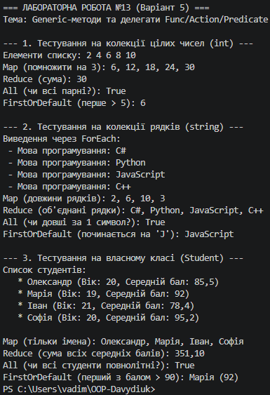

# Лабораторна робота №13: Generic-методи для повторного використання компонентів

## Інформація про роботу
- **Тема:** Generic-методи для повторного використання компонентів: Mapper/MaxBy/Reduce з Func/Action.
- **Варіант:** 5 (`Map`, `Reduce`, `ForEach`, `All`, `OrDefault`)
- **Дисципліна:** Об'єктно-орієнтоване програмування
- **Заклад:** Рівненський фаховий коледж інформаційних технологій (РФКІТ)

---

## Реалізовані методи (Варіант 5)
У класі `FunctionalUtils` реалізовано 5 узагальнених (generic) методів вищого порядку:
1. **`Map<T, TResult>`** — трансформує кожен елемент колекції за допомогою делегата `Func<T, TResult>`.
2. **`Reduce<T, TAccumulate>`** — акумулює (згортає) елементи списку в єдине значення за допомогою `Func<TAccumulate, T, TAccumulate>`.
3. **`ForEach<T>`** — виконує задану дію (`Action<T>`) над кожним елементом колекції.
4. **`All<T>`** — перевіряє за допомогою `Predicate<T>`, чи задовольняють абсолютно всі елементи умову.
5. **`OrDefault<T>`** — шукає та повертає перший елемент за умовою `Predicate<T>` або значення за замовчуванням (`default`), якщо елемент не знайдено.

---

## Висновки
Під час виконання лабораторної роботи було поглиблено практичні навички створення та застосування **узагальнених (generic) методів** у мові C#. 

Освоєно роботу з **функціями вищого порядку** та вбудованими делегатами (`Func`, `Action`, `Predicate`), що дозволяє передавати поведінку (алгоритми обробки даних) у якості параметрів. Продемонстровано універсальність розроблених методів шляхом їх успішного виклику для різних типів даних: вбудованих (`int`, `string`) та користувацьких (`Student`). Лямбда-вирази значно спростили синтаксис передачі логіки в методи, зробивши код чистим, декларативним і зручним для повторного використання.

