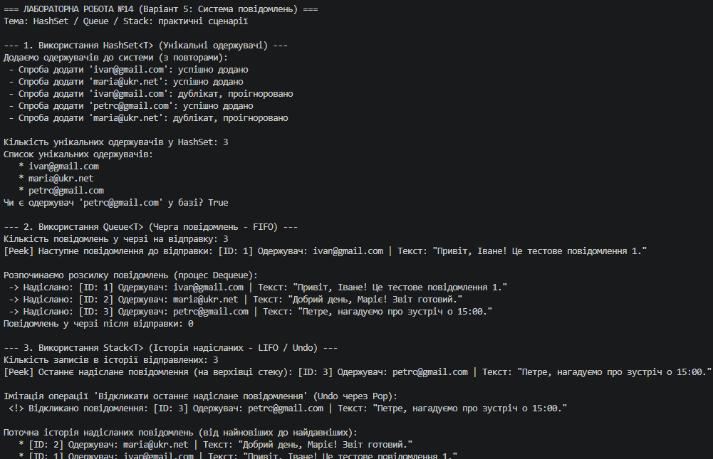

# Лабораторна робота №14: HashSet / Queue / Stack: практичні сценарії

## Інформація про роботу
- **Тема:** HashSet / Queue / Stack: практичні сценарії.
- **Варіант:** 5 (Система повідомлень)
- **Дисципліна:** Об'єктно-орієнтоване програмування
- **Заклад:** Рівненський фаховий коледж інформаційних технологій (РФКІТ)

---

## Реалізовані підзадаки (Варіант 5)
У проєкті реалізовано систему повідомлень із використанням трьох спеціалізованих колекцій .NET:
1. **`HashSet<T>` (Унікальні одержувачі):** Використовується для зберігання списку електронних адрес одержувачів без повторів. Метод `Add()` автоматично відсіює дублікати за час $O(1)$, а `Contains()` дозволяє миттєво перевіряти наявність одержувача.
2. **`Queue<T>` (Черга повідомлень - FIFO):** Реалізує дисципліну *First In, First Out* (першим прийшов — першим вийшов). Повідомлення стають у чергу через метод `Enqueue()`, переглядаються за допомогою `Peek()` та послідовно надсилаються за допомогою `Dequeue()`.
3. **`Stack<T>` (Історія надісланих - LIFO):** Працює за принципом *Last In, First Out* (останнім прийшов — першим вийшов). Надіслані повідомлення потрапляють на вершину стеку через `Push()`. Це дозволяє реалізувати перегляд останніх дій (`Peek()`) або скасування/відкликання останньої відправки (`Pop()` / `Undo`).

---

## Висновки
Під час виконання лабораторної роботи було вивчено особливості та сценарії застосування спеціалізованих колекцій `HashSet<T>`, `Queue<T>` та `Stack<T>`. На практиці продемонстровано переваги використання правильних структур даних для моделювання реальних бізнес-процесів (системи повідомлень), забезпечення унікальності даних, обробки черг подій та ведення історії операцій (LIFO-стеку).

