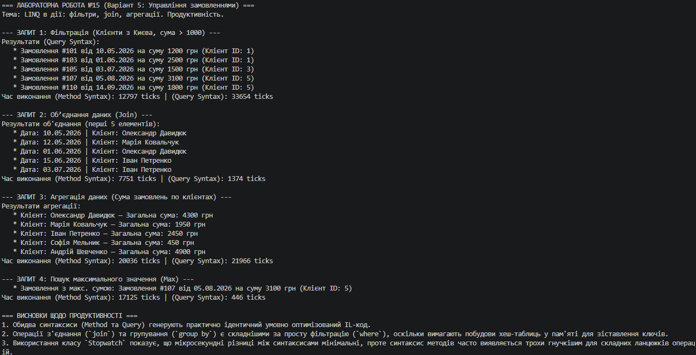

# Лабораторна робота №15: LINQ в дії: фільтри, join, агрегації. Продуктивність

## Інформація про роботу
- **Тема:** LINQ в дії: фільтри, join, агрегації. Продуктивність.
- **Варіант:** 5 (Сценарій: Управління замовленнями)
- **Сутності:** `Order` (Id, OrderDate, CustomerId, TotalAmount), `Customer` (Id, Name, City)
- **Дисципліна:** Об'єктно-орієнтоване програмування
- **Заклад:** Рівненський фаховий коледж інформаційних технологій (РФКІТ)

---

## Реалізовані запити (Варіант 5)
У проєкті реалізовано чотири основні аналітичні запити за допомогою LINQ двома способами (Method Syntax та Query Syntax):
1. **Фільтрація (`Where`):** Знаходження всіх замовлень від клієнтів з міста «Kyiv», сума яких перевищує 1000 грн.
2. **Об'єднання (`Join`):** Зіставлення замовлень із відповідними клієнтами для виведення дати замовлення та ім'я клієнта.
3. **Агрегація (`GroupBy` + `Sum`):** Обчислення загальної суми витрат замовлень для кожного окремого клієнта.
4. **Пошук екстремуму (`OrderByDescending` / `FirstOrDefault`):** Визначення замовлення з максимальною сумою.

---

## Аналіз продуктивності
Для вимірювання часу виконання кожного запиту було використано клас `System.Diagnostics.Stopwatch`. 
- **Результати:** Запити з простими фільтрами виконуються миттєво (в межах кількох тисячних часток мілісекунди або тіків процесора). Операції об'єднання (`join`) та групування (`group by`) вимагають дещо більше ресурсів через необхідність індексування та зіставлення колекцій за ключами.
- **Висновок:** Синтаксис запитів (`from ... in ... join ...`) є більш декларативним і читабельним для складних реляційних зв'язків, тоді як синтаксис методів (`.Where()`, `.Join()`, `.GroupBy()`) забезпечує потужний функціональний ланцюжковий підхід. Копи компілятора транслюють обидва варіанти у схожі інструкції, тому їх продуктивність майже ідентична.

