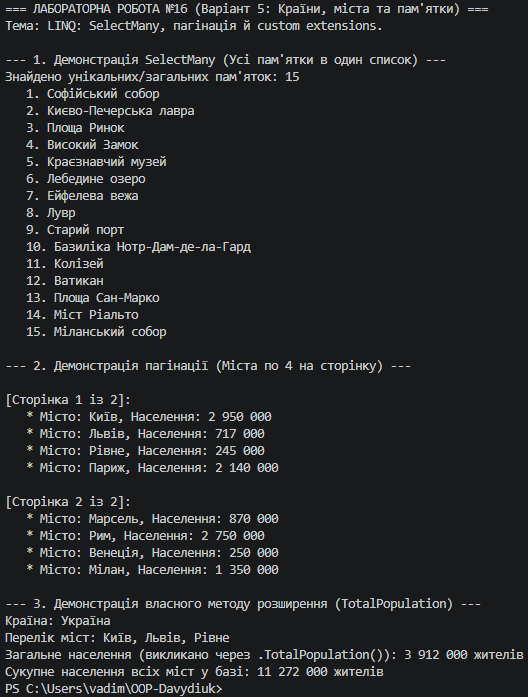

# Лабораторна робота №16: LINQ: SelectMany, пагінація й custom extensions

## Інформація про роботу
- **Тема:** LINQ: SelectMany, пагінація й custom extensions.
- **Варіант:** 5 (Сценарій: Країни та їхні міста з пам'ятками)
- **Сутності:** `Country` (Id, Name, List<City>), `City` (Id, Name, Population, List<Landmark>), `Landmark` (Id, Name)
- **Дисципліна:** Об'єктно-орієнтоване програмування
- **Заклад:** Рівненський фаховий коледж інформаційних технологій (РФКІТ)

---

## Реалізовані завдання (Варіант 5)
У проєкті реалізовано ключові можливості поглибленого використання LINQ:
1. **Оператор `SelectMany`:** Застосовано каскадне «розгортання» (flattening) вкладених колекцій. За допомогою двох послідовних викликів `SelectMany` сформовано єдиний загальний список усіх пам'яток (`Landmark`) з усіх міст усіх країн.
2. **Пагінація (`Skip` та `Take`):** Реалізовано посторінковий вивід списку міст із розрахунком кількості сторінок (по 4 міста на кожну сторінку). Метод `Skip()` пропускає елементи попередніх сторінок, а `Take()` вибирає чітко обмежену кількість елементів поточної сторінки.
3. **Власний метод розширення (Custom Extension Method):** Створено статичний метод `TotalPopulation()` для інтерфейсу `IEnumerable<City>`, який інкапсулює бізнес-логіку обчислення сумарного населення переданої колекції міст.

---

## Висновки
Під час виконання лабораторної роботи було поглиблено навички роботи з ієрархічними структурами даних у .NET за допомогою розширеного набору операторів LINQ. Застосування `SelectMany` дозволило ефективно перетворювати вкладені колекції у пласкі списки. Зв'язка методів `Skip()` та `Take()` надала зручний інструментарій для реалізації класичної пагінації даних. А створення власного методу розширення продемонструвало механізми розширення функціональності існуючих інтерфейсів (`IEnumerable<T>`) без зміни їхнього вихідного коду.

