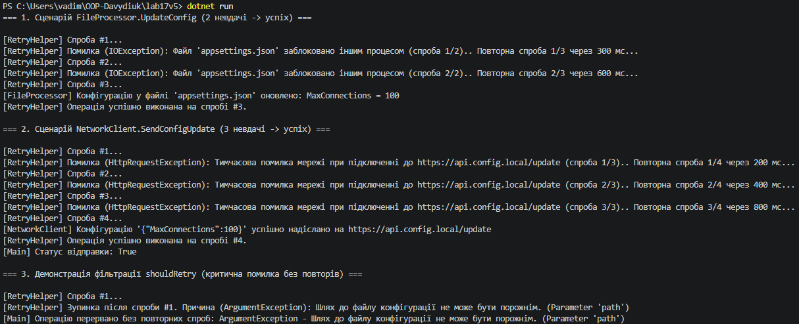

## Висновок

У ході виконання лабораторної роботи №17 було реалізовано патерн Retry з експоненційною затримкою для підвищення відмовостійкості операцій оновлення конфігурації (`FileProcessor` та `NetworkClient`). Експоненційна затримка у класі `RetryHelper` обчислюється за формулою `initialDelay * 2^attempt` (де `attempt` — порядковий номер повторної спроби, починаючи з 0), завдяки чому час очікування подвоюється після кожної невдачі (наприклад, 200 мс, 400 мс, 800 мс). Це дозволяє зменшити навантаження на заблокований файл або перевантажений сервер і дає ресурсу час на відновлення, тоді як делегат `shouldRetry` відсіює критичні помилки (`ArgumentException`), не витрачаючи час на марні повтори.

## Відповіді на контрольні запитання

**1. Які типи винятків найчастіше виникають при роботі з файлами та мережею?**
* **При роботі з файлами (простір імен `System.IO`):** `IOException` (файл зайнятий іншим процесом або помилка читання/запису), `FileNotFoundException` (файл не знайдено), `DirectoryNotFoundException` (відсутня директорія), `UnauthorizedAccessException` (брак прав доступу).
* **При роботі з мережею:** `HttpRequestException` (помилки HTTP-запитів, недоступність вузла, помилки DNS), `SocketException` (збої на рівні мережевих сокетів), `TimeoutException` або `TaskCanceledException` (перевищення часу очікування відповіді).

**2. Поясніть принцип роботи патерну Retry. Коли його доцільно використовувати?**
Патерн Retry полягає в автоматичному повторному виконанні операції, яка завершилася збоєм, із певною паузою між спробами до досягнення успіху або вичерпання ліміту спроб. Його доцільно використовувати лише для **тимчасових (транзієнтних) помилок** — наприклад, короткочасна втрата мережевого з'єднання, тайм-аут API або тимчасове блокування файлу іншим процесом. Для логічних помилок або помилок валідації (неправильний формат даних, 404 Not Found, 401 Unauthorized) патерн не застосовується.

**3. Як реалізувати експоненційну затримку між повторними спробами?**
Експоненційна затримка реалізується шляхом множення базового інтервалу (`initialDelay`) на двійку в степені номера поточної повторної спроби (`attempt`, де перша повторна спроба має індекс `0`):
```csharp
TimeSpan delay = TimeSpan.FromMilliseconds(initialDelay.TotalMilliseconds * Math.Pow(2, currentRetry));
Thread.Sleep(delay); // або await Task.Delay(delay) для асинхронного коду
```
