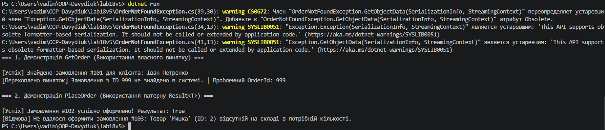

## Висновок

У ході виконання лабораторної роботи №18 було опановано створення власних класів винятків та реалізацію узагальненого патерну `Result<T>` для контрольованої обробки помилок у C#.

На прикладі системи управління замовленнями (`OrderService`) було обґрунтовано та застосовано два різні підходи до обробки збоїв:
1. **Власний виняток `OrderNotFoundException`** використано у методі `GetOrder(int orderId)`. Оскільки контракт методу передбачає повернення конкретного об'єкта замовлення, його відсутність за вказаним ідентифікатором є винятковою ситуацією, яка порушує нормальний потік виконання програми. Додаткова властивість `OrderId` дозволяє коду в блоці `catch` точно ідентифікувати причину помилки.
2. **Патерн `Result<bool>`** застосовано у методі `PlaceOrder(Order order)`. Відсутність товару на складі під час оформлення замовлення є очікуваним і штатним бізнес-сценарієм, а не критичним системним збоєм. Повернення результату через `Result.Success` або `Result.Failure` дозволяє уникнути накладних витрат на генерацію та перехоплення винятків, роблячи логіку обробки помилок явною та передбачуваною.

## Відповіді на контрольні запитання

**1. Навіщо створювати власні типи винятків? Які переваги це дає?**
Власні винятки дозволяють описувати специфічні для конкретної предметної області помилки, коли стандартних класів .NET недостатньо. Основні переваги:
* **Точне перехоплення:** можливість обробляти конкретний тип помилки в окремому блоці `catch`, не зачіпаючи інші системні винятки.
* **Додатковий контекст:** можливість зберігати у властивостях винятку специфічні дані про збій (наприклад, `OrderId`, код статусу тощо).
* **Зрозумілість коду:** назва класу одразу вказує на суть проблеми.

**2. Які стандартні конструктори рекомендується реалізовувати для власних винятків?**
Рекомендується реалізовувати чотири стандартні конструктори:
* конструктор без параметрів: `public CustomException()`;
* конструктор із повідомленням: `public CustomException(string message)`;
* конструктор із повідомленням та внутрішнім винятком: `public CustomException(string message, Exception innerException)`;
* захищений конструктор для серіалізації: `protected CustomException(SerializationInfo info, StreamingContext context)`.

**3. Поясніть патерн Result. У яких випадках його використання є більш доцільним, ніж викидання винятків?**
Патерн `Result<T>` інкапсулює результат виконання операції в єдиний об'єкт, який містить прапорець успіху (`IsSuccess`), значення при успіху (`Value`) або опис помилки (`Error`). Його доцільно використовувати тоді, коли невдача є частим і передбачуваним сценарієм роботи (помилки валідації даних, відсутність товару на складі, невдала авторизація), оскільки це дозволяє уникнути ресурсомісткого механізму розкручування стеку винятків.

**4. Які сценарії краще обробляти через винятки, а які через патерн Result?**
* **Через винятки:** непередбачувані технічні або інфраструктурні збої (втрата з'єднання з базою даних, відсутність файлу, мережеві помилки) та порушення контрактів методу (наприклад, передача `null` замість обов'язкового об'єкта).
* **Через патерн Result:** очікувані помилки бізнес-логіки та перевірки користувацького вводу (недостатньо коштів на рахунку, зайнятий логін при реєстрації, відсутність потрібної кількості товару).

